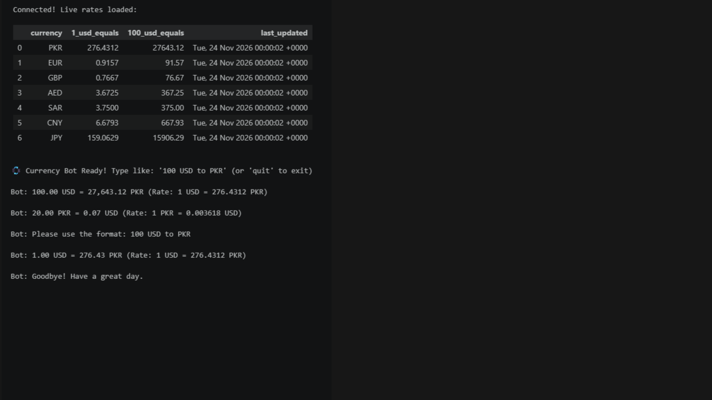
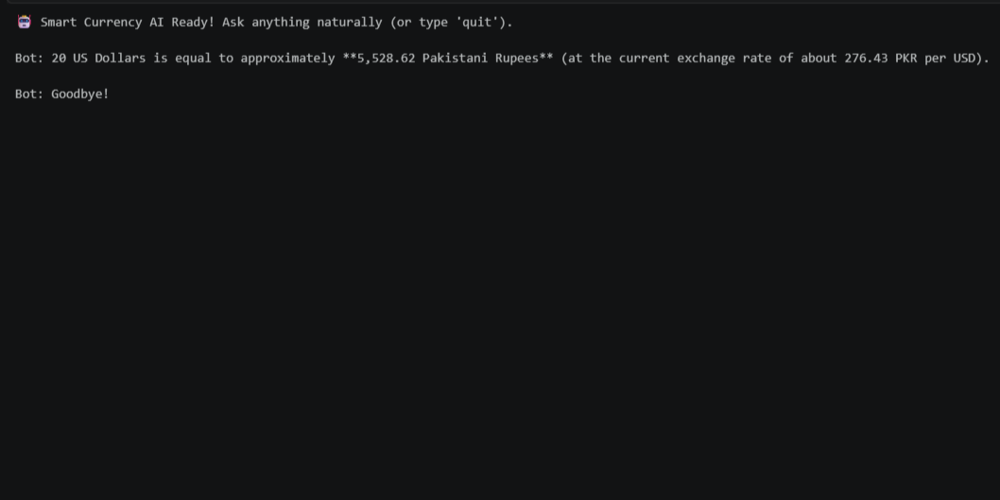

# Live FX Assistant: Rule-Based Pipeline to Agentic AI

An evolutionary FinTech & AI project demonstrating how upgrading from rigid string parsing to **LLM Function Calling** solves user-input friction while keeping financial calculations grounded in real-time market data.

---

## Project Architecture & Progression

### Stage 1: Rule-Based FX Pipeline (`01_rule_based_fx_bot.ipynb`)
* **Tech Stack:** Python, `requests`, `pandas`, ExchangeRate-API
* **What it does:** Fetches live USD exchange rates into a structured `pandas` DataFrame (`PKR`, `EUR`, `GBP`, `AED`, `SAR`, `CNY`, `JPY`) and runs a CLI converter using positional string splitting (`100 USD to PKR`).
* **Bottleneck Identified:** Breaks whenever a user types natural conversational phrasing (e.g., *"How much is 20 dollars in Pakistani rupees?"*).



### Stage 2: Agentic AI Currency Assistant (`02_agentic_gemini_fx_bot.ipynb`)
* **Tech Stack:** Python, `google-genai` (`gemini-3.5-flash-lite`), Custom Tool Calling, ExchangeRate-API
* **What it does:** Wraps the live API call in a typed Python function (`convert_currency`) registered as an LLM tool. Gemini extracts intent and currency codes from natural speech, calls the live API to prevent numerical hallucinations, and returns a conversational answer.



---

## How to Run Locally

1. **Clone the repository:**
   ```bash
   git clone [https://github.com/palwashausman/currency-converter-ai-evolution.git](https://github.com/palwashausman/currency-converter-ai-evolution.git)
   cd currency-converter-ai-evolution
   ```

2. **Install dependencies:**
   ```bash
   pip install -r requirements.txt
   ```

3. **Set up your API keys:**
   Set your Gemini API key (and ExchangeRate-API key if your notebook uses the authenticated endpoint) as environment variables—or enter them when prompted at runtime:
   ```bash
   # On macOS/Linux:
   export GEMINI_API_KEY="your_gemini_api_key_here"

   # On Windows (Command Prompt):
   set GEMINI_API_KEY=your_gemini_api_key_here
   ```

4. **Launch Jupyter Notebook:**
   ```bash
   jupyter notebook
   ```
   Open `01_rule_based_fx_bot.ipynb` or `02_agentic_gemini_fx_bot.ipynb` and run the cells.
